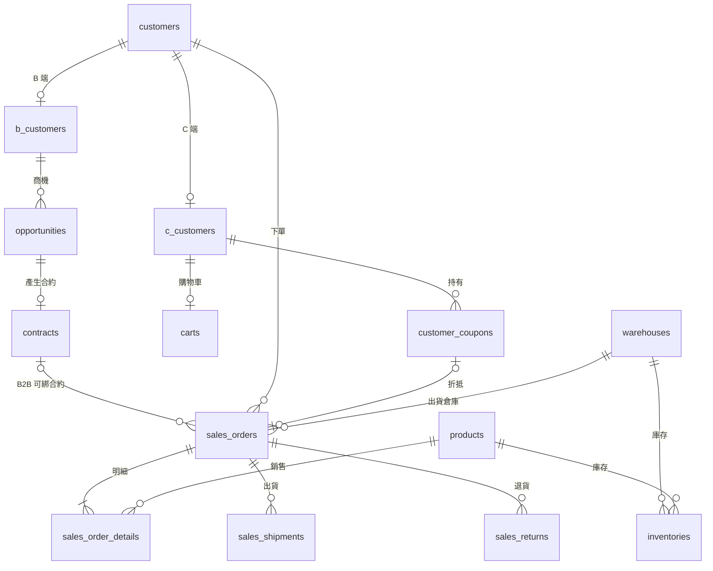
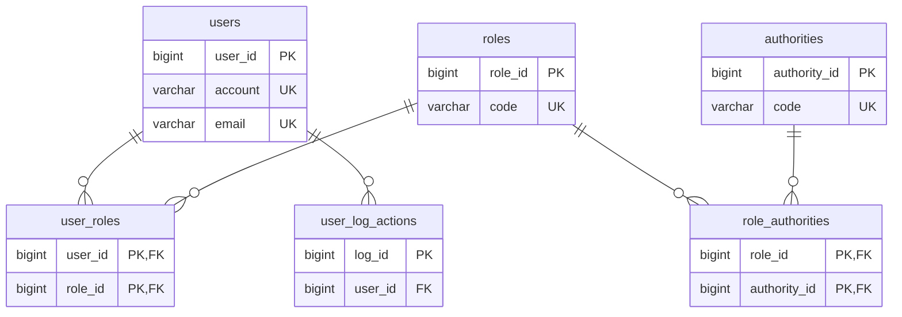
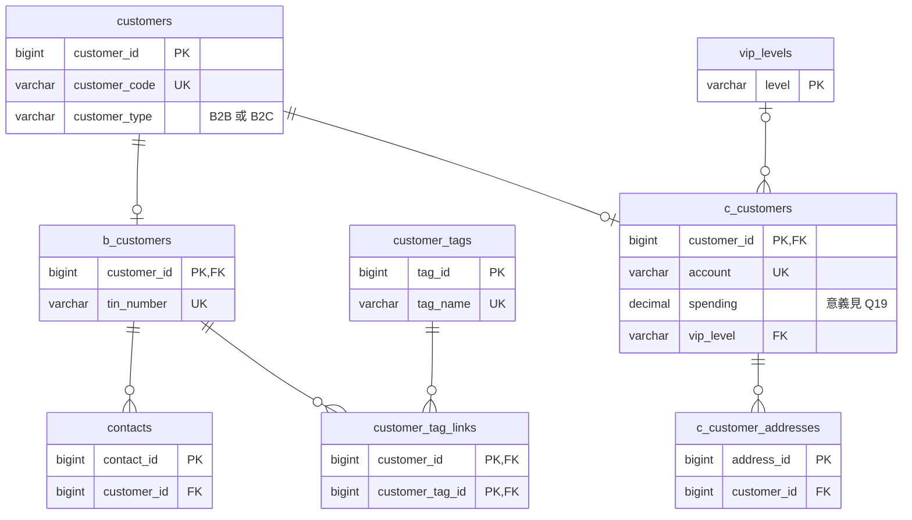
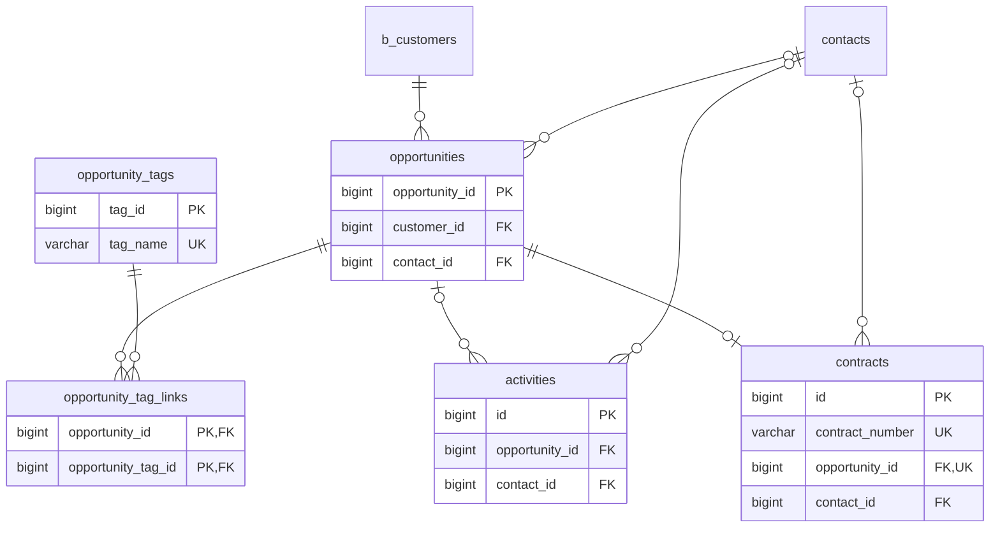
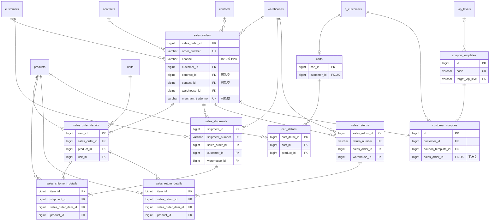
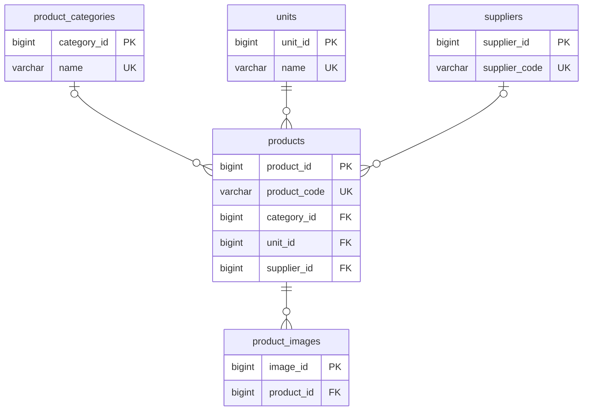
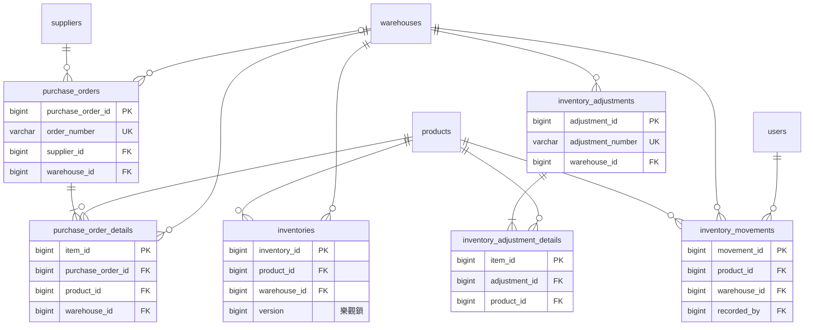
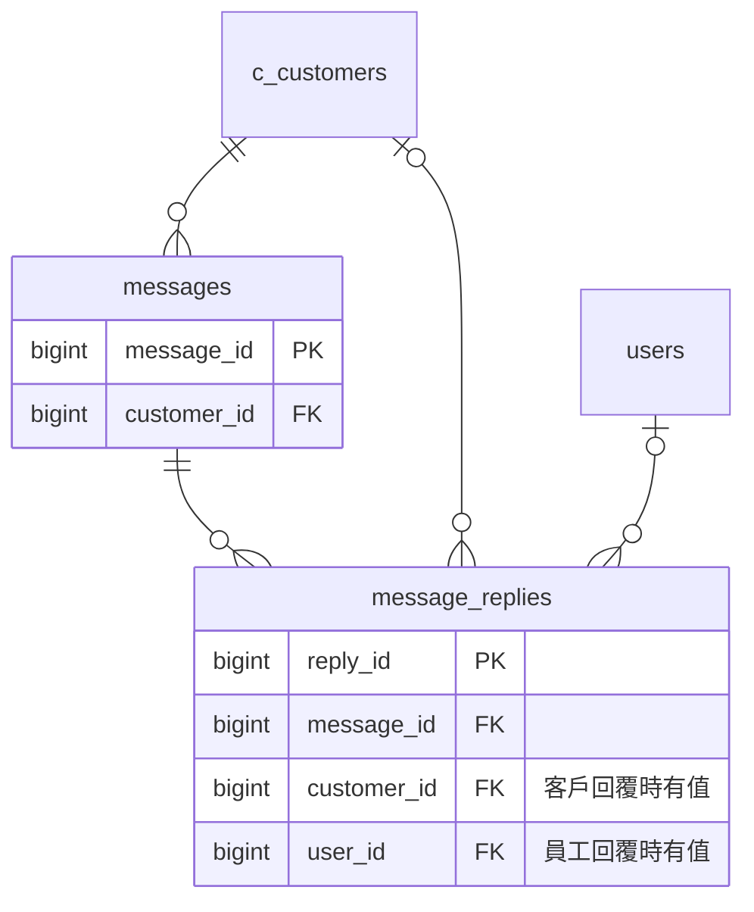

# 資料模型

Flyway V1 要建立的目標結構，共 47 張資料表。決定的原因和取捨見 [ADR 0001](adr/0001-data-model.md)。

這份文件描述**目標**，目前程式和資料庫還是舊結構。V1 完成後，這裡要和 migration 保持同步。

標示 `Q` 編號的項目對應 ADR 第 8 節，是否已定案看該節的狀態表；尚未定案的項目先依建議畫出來，定案後要更新。

這份文件包含產品範圍第一批的欄位。第二批（業務負責人、報價單、應收應付、付款條件、電子發票）在 V1 之後加入，不在這裡，見 ADR 第 5 節。

## 1. 總覽

Mermaid 是用文字描述圖表的語法，GitHub 會直接畫出來。關聯線的符號：`||` 是剛好一筆，`o|` 是零或一筆，`o{` 是零或多筆，`|{` 是一或多筆。

這張圖只放跨模組的主要流程：

- B2B：商機 → 合約 → 銷貨單 → 出貨。
- B2C 從購物車下單，同樣進入銷貨單。
- 出貨後可以退貨，退貨單指向原銷貨單。

`carts` 和 `sales_orders` 之間沒有外鍵：下單時把購物車內容複製成訂單明細，然後刪除購物車。

## 2. 資料表

共用規則：

- 主鍵都是自動遞增的 `BIGINT`，例外是 `vip_levels`（字串主鍵）和中介表（複合主鍵）。
- 「稽核欄位」指 `created_by`、`created_at`、`updated_by`、`updated_at`，其中 `created_by`、`updated_by` 是指向 `users.user_id` 的外鍵，客戶操作時記到系統使用者。為了閱讀，下面的關聯圖不畫這些線。
- 共用欄位依 ADR Q21 分級：會被修改的業務資料表都有稽核欄位；只新增不修改的紀錄只有建立的人和時間；`version` 只放在 `inventories`、`sales_orders`、`purchase_orders`。下面的表格只列各表專屬欄位，實作時以這條規則補齊。
- 金額和數量是 `DECIMAL(18,2)`（Q12）；稅率是 `DECIMAL(5,4)`（Q16）。
- 外鍵欄位標示「→ 參照的資料表」，「UK」是唯一限制。

### 2.1 員工與權限

| 資料表 | 主鍵 | 外鍵 | 主要欄位 |
|---|---|---|---|
| `users` | `user_id` | | `user_name`、`account` UK、`password`、`email` UK、`last_login`、`access_start_date`、`access_end_date`、`is_active`、`is_deleted`、`created_at`、`updated_at` |
| `authorities` | `authority_id` | | `code` UK、`module`、`module_group`、`display_name`、`description`；畫面和按鈕也用權限代碼（Q22） |
| `roles` | `role_id` | 稽核欄位 | `code` UK、`name`、`description` |
| `user_roles` | (`user_id`, `role_id`) | `user_id` → `users`；`role_id` → `roles` | |
| `role_authorities` | (`role_id`, `authority_id`) | `role_id` → `roles`；`authority_id` → `authorities` | |
| `user_log_actions` | `log_id` | `user_id` → `users` | `action_type`、`description`、`target_table`、`target_id`、`ip_address`、`user_agent`、`created_at` |
| `password_reset_tokens` | `id` | | `email`、`token`、`created_at`、`expires_at`、`used` |

### 2.2 客戶

`customers`、`b_customers`、`c_customers` 是 JOINED 繼承：子表的 `customer_id` 同時是主鍵和指向 `customers` 的外鍵。

| 資料表 | 主鍵 | 外鍵 | 主要欄位 |
|---|---|---|---|
| `customers`（Q7） | `customer_id` | 稽核欄位 | `customer_code` UK、`name`、`customer_type`、`is_active`、`is_deleted`、`address`、`email`、`phone` |
| `b_customers` | `customer_id` | `customer_id` → `customers` | `industry`、`relationship_type`（Q7，不含 `VENDOR`）、`customer_level`（Q7）、`tin_number` UK |
| `c_customers`（Q7） | `customer_id` | `customer_id` → `customers`；`vip_level` → `vip_levels` | `account` UK、`password`、`birthday`、`last_login`、`access_start_time`、`access_end_time`、`third_party_uid` UK、`spending`（`NOT NULL DEFAULT 0`，意義見 Q19） |
| `c_customer_addresses`（Q7） | `address_id` | `customer_id` → `c_customers` | `name`、`phone`、`address`、`is_default`、`created_at`、`updated_at` |
| `vip_levels` | `level` | | `upgrade_threshold`、`downgrade_threshold`、`bonus_description`、`free_shipping`（Q19）、`discount_rate`（Q19） |
| `contacts` | `contact_id` | `customer_id` → `b_customers` | `contact_name`、`contact_title`、`email`、`contact_phone`、`contact_notes`、`created_at`、`updated_at` |
| `customer_tags` | `tag_id` | | `tag_name` UK、`color` |
| `customer_tag_links` | (`customer_id`, `customer_tag_id`) | `customer_id` → `b_customers`；`customer_tag_id` → `customer_tags` | |

### 2.3 CRM

| 資料表 | 主鍵 | 外鍵 | 主要欄位 |
|---|---|---|---|
| `opportunities` | `opportunity_id` | `customer_id` → `b_customers`；`contact_id` → `contacts` | `opportunity_name`、`description`、`expected_value`、`close_date`、`stage`（必填，Q11）、`priority`、`created_at`、`updated_at` |
| `opportunity_tags` | `tag_id` | | `tag_name` UK、`color` |
| `opportunity_tag_links` | (`opportunity_id`, `opportunity_tag_id`) | `opportunity_id` → `opportunities`；`opportunity_tag_id` → `opportunity_tags` | |
| `activities` | `id` | `opportunity_id` → `opportunities`；`contact_id` → `contacts` | `title`、`activity_type`、`start_time`、`end_time`、`status`、`notes`、`created_at`、`updated_at` |
| `contracts` | `id` | `opportunity_id` → `opportunities`，UK，必填（Q10）；`contact_id` → `contacts` | `contract_number` UK、`title`、`contract_type`、`status`、`start_date`、`end_date`、`amount`、`terms_and_conditions`、`created_at`、`updated_at` |

商機狀態不存資料表，由 `stage` 推算：`CLOSED_WON` 是 `WON`，`CLOSED_LOST` 是 `LOST`，其他階段是 `OPEN`。

### 2.4 銷售、退貨、購物車與優惠券

| 資料表 | 主鍵 | 外鍵 | 主要欄位 |
|---|---|---|---|
| `sales_orders` | `sales_order_id` | 見下表 | 見下表 |
| `sales_order_details` | `item_id` | `sales_order_id` → `sales_orders`；`product_id` → `products`；`unit_id` → `units`（Q11）；稽核欄位 | `item_sequence`、`specification`、`quantity`、`shipped_quantity`（`NOT NULL DEFAULT 0`）、`unit_price`、`item_amount`、`discount_rate`、`tax_rate`（Q16）、`item_net_amount`、`item_tax_amount`、`remarks` |
| `sales_shipments` | `shipment_id` | `sales_order_id` → `sales_orders`（Q11）；`customer_id` → `customers`；`warehouse_id` → `warehouses`；稽核欄位 | `shipment_number` UK、`shipment_date`、`shipping_method`、`tracking_number`、`status` |
| `sales_shipment_details` | `item_id` | `shipment_id` → `sales_shipments`；`sales_order_item_id` → `sales_order_details`（Q11）；`product_id` → `products` | `shipped_quantity` |
| `sales_returns` | `sales_return_id` | `sales_order_id` → `sales_orders`；`warehouse_id` → `warehouses`；稽核欄位 | `return_number` UK、`return_date`、`status`（Q17）、`refund_status`（Q17）、`refund_amount`、`reason`、`remarks` |
| `sales_return_details` | `item_id` | `sales_return_id` → `sales_returns`；`sales_order_item_id` → `sales_order_details`；`product_id` → `products` | `returned_quantity`、`refund_amount` |
| `carts` | `cart_id` | `customer_id` → `c_customers`，UK | `created_at`、`updated_at` |
| `cart_details` | `cart_detail_id` | `cart_id` → `carts`；`product_id` → `products` | `quantity`、`added_at` |
| `coupon_templates` | `id` | `target_vip_level` → `vip_levels` | `name`、`description`、`code` UK、`coupon_type`、`discount_value`、`min_purchase_amount`、`max_discount_amount`、`valid_from`、`valid_to`、`total_quantity`、`issued_quantity`、`status` |
| `customer_coupons` | `id` | `customer_id` → `c_customers`；`coupon_template_id` → `coupon_templates`；`sales_order_id` → `sales_orders`，UK，可為空 | `status`、`received_at`、`used_at` |

`sales_orders` 是這次改動最大的資料表，完整欄位如下：

| 欄位 | 型別 | 必填 | 說明 |
|---|---|---|---|
| `sales_order_id` | BIGINT | 是 | 主鍵 |
| `order_number` | VARCHAR(50) | 是 | UK |
| `channel` | VARCHAR(10) | 是 | **新增**，`B2B` 或 `B2C`（Q6） |
| `customer_id` | BIGINT | 是（Q11） | → `customers` |
| `contract_id` | BIGINT | 否 | **新增** → `contracts`，B2C 一律為空 |
| `contact_id` | BIGINT | 否 | 舊 `contact_person_id` 改外鍵 → `contacts` |
| `warehouse_id` | BIGINT | 是 | → `warehouses` |
| `order_date` | DATE | 是 | |
| `currency` | VARCHAR(10) | 是 | 預設 `TWD` |
| `discount_amount` | DECIMAL(18,2) | 是 | **新增**（Q3），預設 0 |
| `shipping_fee` | DECIMAL(18,2) | 是 | **新增**，預設 0，CRM-45 |
| `total_amount` | DECIMAL(18,2) | 是 | 客戶實付金額，包含運費（Q3） |
| `total_tax_amount` | DECIMAL(18,2) | 是 | |
| `total_net_amount` | DECIMAL(18,2) | 是 | |
| `payment_method` | VARCHAR(50) | 是 | 對應 enum（Q2） |
| `payment_status` | VARCHAR(20) | 是 | `PaymentStatus` |
| `paid_at` | DATETIME | 否 | **新增**（Q20） |
| `order_status` | VARCHAR(20) | 是 | 訂單本身的狀態，不含出貨進度（Q1） |
| `shipping_status` | VARCHAR(20) | 是 | **新增**，預設 `NOT_SHIPPED`（Q1） |
| `merchant_trade_no` | VARCHAR(50) | 否 | **搬移**自 `orders`，UK |
| `shipping_method` | VARCHAR(50) | 是（Q4） | |
| `shipping_address` | VARCHAR(500) | 是 | 下單時複製 |
| `recipient_name` | VARCHAR(100) | 否 | **新增**（Q5） |
| `recipient_phone` | VARCHAR(30) | 否 | **新增**（Q5） |
| `estimated_delivery_date` | DATE | 否 | |
| `remarks` | TEXT | 否 | |
| `version` | BIGINT | 是 | **新增**，預設 0（Q21） |
| 稽核欄位 | | 是 | |

已移除：`quotation_id`、`contact_person_id`（改為 `contact_id`）。

### 2.5 商品

| 資料表 | 主鍵 | 外鍵 | 主要欄位 |
|---|---|---|---|
| `products` | `product_id` | `category_id` → `product_categories`；`unit_id` → `units`；`supplier_id` → `suppliers`；稽核欄位 | `product_code` UK、`name`、`description`、`is_purchasable`、`is_salable`、`base_price`、`tax_type`（Q16）、`cost_method`、`safety_stock_quantity`、`is_active` |
| `product_categories` | `category_id` | `created_by`、`updated_by` → `users` | `name` UK |
| `product_images` | `image_id` | `product_id` → `products` | `image_url` |
| `units` | `unit_id` | `created_by`、`updated_by` → `users` | `name` UK |
| `suppliers` | `supplier_id` | 稽核欄位（`updated_by`、`updated_at` 是新增，Q9） | `supplier_code` UK、`name`、`is_active` |
| `warehouses` | `warehouse_id` | 稽核欄位（`updated_by`、`updated_at` 是新增，Q9） | `name` UK、`is_active` |

### 2.6 採購與庫存

| 資料表 | 主鍵 | 外鍵 | 主要欄位 |
|---|---|---|---|
| `purchase_orders` | `purchase_order_id` | `supplier_id` → `suppliers`；`warehouse_id` → `warehouses`（Q11）；稽核欄位 | `order_number` UK、`order_date`、`status`、`currency`、`total_amount`、`total_tax_amount`、`total_net_amount`、`total_cost_amount`、`remarks`、`version`（Q21） |
| `purchase_order_details` | `item_id` | `purchase_order_id` → `purchase_orders`；`product_id` → `products`；`warehouse_id` → `warehouses`；稽核欄位 | `quantity`、`received_quantity`（`NOT NULL DEFAULT 0`）、`unit_price`、`tax_rate`（Q16）、`item_amount`、`item_tax_amount`、`item_net_amount`、`is_gift` |
| `inventories` | `inventory_id` | `product_id` → `products`；`warehouse_id` → `warehouses`；稽核欄位 | `current_stock`、`average_cost`、`units_on_order`、`units_allocated`、`version`（`NOT NULL DEFAULT 0`）；UK (`product_id`, `warehouse_id`)（Q11） |
| `inventory_adjustments` | `adjustment_id` | `warehouse_id` → `warehouses`；稽核欄位 | `adjustment_number` UK、`adjustment_date`、`adjustment_type`、`status`、`remarks` |
| `inventory_adjustment_details` | `item_id` | `adjustment_id` → `inventory_adjustments`；`product_id` → `products`；稽核欄位 | `adjusted_quantity`、`remarks` |
| `inventory_movements` | `movement_id` | `product_id` → `products`；`warehouse_id` → `warehouses`；`recorded_by` → `users` | `movement_type`、`quantity_change`、`current_stock_after_movement`、`document_type`、`document_id`、`document_item_id`、`movement_date`、`unit_cost_at_movement`、`total_cost_change` |

`document_id` 依 `document_type` 指向不同單據，無法加外鍵（Q11）。分批收貨的每次紀錄也在這裡（Q18）。

### 2.7 客服

| 資料表 | 主鍵 | 外鍵 | 主要欄位 |
|---|---|---|---|
| `messages` | `message_id` | `customer_id` → `c_customers` | `question_title`、`created_at`、`is_resolved` |
| `message_replies` | `reply_id` | `message_id` → `messages`；`customer_id` → `c_customers`；`user_id` → `users` | `sender_type`、`content`、`sent_at` |

### 2.8 系統參數與代碼表

`system_params` 存放稅率、運費等可調參數，見 [ADR 0002](adr/0002-modular-monolith.md)。模組裝不裝由啟動設定決定，不放這裡。這三張資料表的關聯很單純，所以不另外畫圖。

| 資料表 | 主鍵 | 外鍵 | 主要欄位 |
|---|---|---|---|
| `system_params` | `param_key` | `updated_by` → `users`（Q15） | `param_value`、`description`、`updated_at` |
| `code_groups` | `group_code` | 稽核欄位 | `name`、`description` |
| `code_items` | `code_item_id` | `group_code` → `code_groups`；稽核欄位 | `item_code`、`display_name`、`sort_order`、`is_active`；UK (`group_code`, `item_code`) |

代碼表存狀態的顯示名稱、排序，以及退貨原因這類由營運維護的選項（Q22）。狀態值本身仍是 Java enum，兩邊用測試檢查一致。

## 3. 新舊對照

### 3.1 資料表

| 舊名 | 新名 | 異動 |
|---|---|---|
| `orders`、`orderdetails` | | 刪除，併入 `sales_orders`、`sales_order_details` |
| `employees`、`platforms` | | 刪除 |
| `user` | `users` | 改名 |
| `authority` | `authorities` | 改名 |
| `user_authority` | | 刪除，改用 `roles`、`user_roles`、`role_authorities` |
| `userlogaction` | `user_log_actions` | 改名 |
| `password_reset_token` | `password_reset_tokens` | 改名 |
| `customer_base` | `customers` | 改名（Q7） |
| `customer` | `c_customers` | 改名（Q7） |
| `customer_address` | `c_customer_addresses` | 改名（Q7） |
| `viplevel` | `vip_levels` | 改名 |
| `customer_tags_link` | `customer_tag_links` | 改名 |
| `opportunity_tags_link` | `opportunity_tag_links` | 改名 |
| `Sales_order_details` | `sales_order_details` | 改名 |
| `cartdetails` | `cart_details` | 改名 |
| `productimgs` | `product_images` | 改名 |
| `message` | `messages` | 改名 |
| `message_reply` | `message_replies` | 改名 |

`sales_returns`、`sales_return_details`、`system_params`、`code_groups`、`code_items`、`roles`、`user_roles`、`role_authorities` 是新增的資料表。其他資料表名稱不變。

### 3.2 欄位

| 資料表 | 舊欄位 | 新欄位 |
|---|---|---|
| `carts` | `cartid`、`createat`、`updateat` | `cart_id`、`created_at`、`updated_at` |
| `cart_details` | `cartdetailid`、`cartid`、`productid`、`addat` | `cart_detail_id`、`cart_id`、`product_id`、`added_at` |
| `c_customer_addresses` | `addressid`、`isdefault`、`createat`、`updateat` | `address_id`、`is_default`、`created_at`、`updated_at` |
| `product_images` | `imgid`、`imgurl`、`productid` | `image_id`、`image_url`、`product_id` |
| `customers` | `customertel`、`spending` | `phone`；`spending` 移到 `c_customers` |
| `b_customers` | `bcustomer_type`、`bcustomer_level` | `relationship_type`、`customer_level`（Q7） |
| `users` | `role_name` | 刪除，改用角色資料表 |
| `opportunities` | `status`、`total_rating_sum`、`number_of_ratings` | 刪除 |
| `sales_orders` | `contact_person_id`、`quotation_id` | `contact_id`；`quotation_id` 刪除 |
| `sales_order_details` | `transaction_number` | 刪除（Q11） |
| `customer_coupons` | `order_id` | `sales_order_id` |
| `vip_levels` | `upgrade_threshold`、`downgrade_threshold`（double） | 名稱不變，改 DECIMAL |
